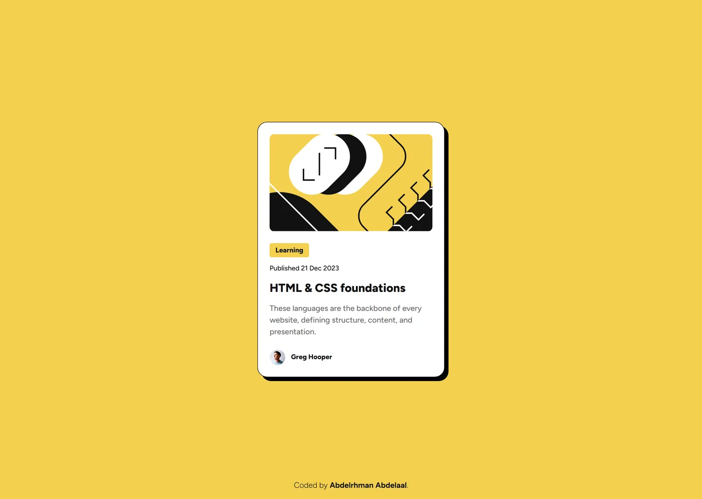

# Blog preview card

My solution to the [Blog preview card](https://www.frontendmentor.io/challenges/blog-preview-card-ckPaj01IcS)
challenge on Frontend Mentor.

- Live: https://blog-preview-card.abdelrhman-ahmed8881.workers.dev
- Code: https://github.com/MrBlackvanta/blog-preview-card

## Built with

- React 19 and Vite
- TypeScript
- Tailwind CSS v4
- Figtree from Google Fonts

## Notes

The type scale from the style guide lives in `src/index.css` as `@utility text-preset-*`
classes rather than being repeated across the JSX. Colours go in `@theme`.

The illustration is imported as a React SVG component so it bundles with the app instead
of costing a request.

The date is a `<time dateTime>` element, and the card is a `<section>` with the avatar
row as a `<figure>`.

## Author

- [LinkedIn](https://www.linkedin.com/in/abdelrhman-vanta/)
- [UpWork](https://www.upwork.com/freelancers/mrblackvanta)
- [Frontend Mentor](https://www.frontendmentor.io/profile/MrBlackvanta)
